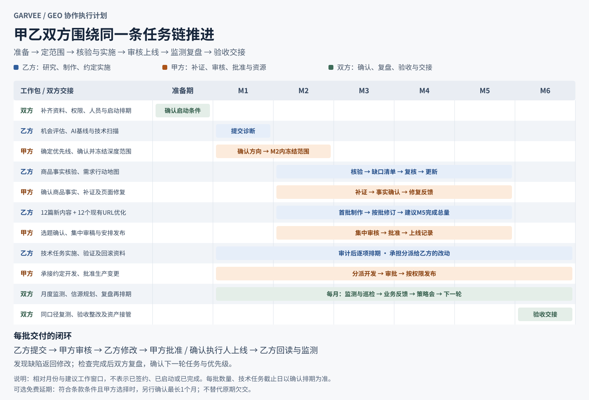
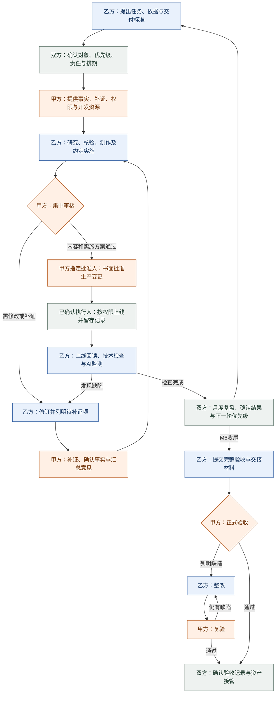

# GARVEE GEO 协作执行计划

**甲方 GARVEE × 乙方 Global Gravity (HK) Limited**

从启动准备到六个月交付，双方围绕同一条任务链协作：**确定范围 → 补齐事实 → 制作与实施 → 审核与修改 → 批准上线 → 监测复盘 → 确定下一轮任务**。

> 本文为依据1023版待签合同修订稿整理的拟定执行安排，不表示已经签约、启动、交付或上线。甘特图为建议排期；实际日期、每批数量和逐项责任以双方确认的启动单与任务台账为准。

## 1. 六个月协作甘特图

**时间口径：**正式服务期为六个完整连续自然月。月中启动时，剩余日期为准备期，M1从次月1日开始。图中使用相对月份，不预设日历日期；条带表示建议工作窗口，不代表已完成进度。

| 时间 | 乙方先交什么 | 甲方如何接续 | 双方怎样完成本阶段 |
|---|---|---|---|
| **准备期** | 资料与权限自检表、缺口清单、人员与数据口径、启动排期 | 指定统筹人和批准人；提供商品资料、权限及开发资源 | 确认启动条件、责任人、实际M1—M6日期及交付排期 |
| **M1：诊断与定方向** | 10条产品线机会排序、AI表现基线、12个关键页面扫描、最多12项高优先级整改建议 | 确认最多4条优先线；解释商品与业务约束；分配整改执行人和批准人 | 共同确认优先范围、基线口径、技术任务清单及排期 |
| **M2：冻结执行范围** | 分批建立产品族、SPU、SKU及目标页面清单；提交首批核验、内容与实施任务 | 确认在售对象、型号及优先级；反馈商品事实和补证；确认首批选题 | M2内分批冻结最多12个产品族、20个SPU、4,000条在售SKU；范围与版本可追踪 |
| **M2—M3：首批实施** | 商品事实核验与需求行动地图、首批英文新内容及页面优化、分派给乙方的技术改动 | 补证并汇总审稿意见；承接分派给甲方的开发及数据更新；批准并安排发布 | 每批走完“提交—审核—修改—批准—上线—回读”；第90天阶段复盘 |
| **M4—M5：持续交付** | 按建议排期完成12篇新内容、12个现有页面优化；持续推进约定整改与监测 | 持续审稿、补证、发布及修复；推进媒体联系和外部发布 | 按总量清单核对交付、审核、上线状态；根据月报调整下一批任务 |
| **M6：复测与收尾** | 同口径复测、终期报告、完整验收材料、缺陷整改、可编辑资产与遗留事项 | 商品、内容、技术和数据分别验收；汇总意见并复验；指定接管人 | 完成验收闭环、资产接管与后续维护安排；第180天阶段复盘 |

内容交付总量须在六个月内完成；M4—M5集中完成是本执行计划的建议安排。技术整改在M1审计后逐项确定截止日，甘特图不代表约定所有整改均在M3完成。第90/180天复盘的具体日期随实际启动排期确认。

## 2. 每批任务的甲乙闭环

**每项任务使用同一条记录：**对象/URL/SKU、范围版本、交付标准、执行人、审核人、批准人、截止日、依赖资料、当前状态及结果证据。状态按“待资料 → 制作中 → 待审核 → 修改中 → 待批准 → 待上线 → 已上线待验证 → 已验证”流转；发现缺陷重新打开任务。

**上线分工逐项落实：**内容制作、录入、页面修改、技术开发、批准、发布、回读和回滚分别指定责任与权限。乙方承担分派给自己的后台/主题整改；甲方或其技术伙伴承接分派给自己的开发及批量更新。发布前完成备份、变更和回滚说明，取得指定批准人书面批准。

## 3. 双方交接时限

| 交接动作 | 时间要求 | 接续动作 |
|---|---|---|
| 甲方提交启动自检结果 → 乙方反馈缺口 | 乙方收到后2个工作日 | 列明受影响任务、责任人和最晚补齐日期；继续推进可并行任务 |
| 乙方提交内容 → 甲方集中审核 | 甲方3—5个工作日 | 每轮一次性汇总商品事实、品牌表达及技术意见 |
| 甲方反馈普通修改 → 乙方修订 | 乙方5个工作日 | 每项内容含2轮汇总修改；再次提交甲方审核 |
| 乙方列出SKU补证项 → 甲方补证 → 乙方复核 | 甲方5个工作日；乙方收到补证后5个工作日 | 更新逐ID台账，分开记录待补证、已核验、待修复及已修复 |
| 乙方备齐正式验收材料 → 甲方验收 | 材料齐备次一工作日起7个工作日 | 甲方书面反馈验收结果或具体缺陷 |
| 甲方给出具体缺陷 → 乙方整改 → 甲方复验 | 乙方收到意见后5个工作日整改；甲方5个工作日复验 | 复验通过后关闭缺陷并更新验收记录 |

工作日按合同定义为香港银行工作日；未明确的计时起点在任务记录中落实。事实错误、漏项、侵权、错误配置等缺陷整改不占普通修改轮次。审稿通过、正式验收及批准上线分别记录。

## 4. 贯穿M1—M6的月度循环

**乙方监测与巡检 → 甲方补充业务变化 → 双方策略会确定优先级 → 分派任务并执行批次闭环 → 乙方月报记录结果 → 进入下月。**

| 节奏 | 乙方负责 | 甲方配合 | 共同留下的结果 |
|---|---|---|---|
| **每月AI监测与1份月报** | 监测ChatGPT、Google AI、Perplexity；汇总表现与执行情况 | 提供同口径数据及促销、价格、库存等变化 | 月报、观察记录与下一轮行动清单 |
| **每月1次技术巡检** | 复查问题、验证约定改动并更新清单 | 处理分派给甲方的开发、修复与发布 | 任务关闭证据、遗留项与新排期 |
| **每月重点SKU事实更新** | 核验事实变化、维护补证与核验台账 | 确认型号、参数、认证及政策；更新受影响页面 | 事实资产、核验结论与页面修复状态 |
| **每月外部信源规划更新** | 更新10个优先媒体/测评来源机会、2个传播选题及行动清单 | 品牌/PR推进联络、采购、样机及实际发布 | 来源机会、选题、成稿及发布链接分别记录 |
| **每月1次策略会、2次进度沟通** | 汇报交付、问题和建议 | 统筹资源，汇总反馈，决定下月优先级 | 策略会纪要、进度记录、负责人及截止日 |
| **第90天、第180天** | 提交阶段复盘 | 确认调整方向或终期接管安排 | 阶段报告与后续任务 |

媒体机会清单的“更新”不等于每月新增10个来源；传播选题不等于已经发布。外部合作费用及实际发布由甲方推进，新增费用事前批准。

## 5. 交付范围与收尾

| 工作包 | 六个月范围 |
|---|---|
| 市场与站点 | 美国市场、英文、garvee.com |
| 机会评估与深度范围 | 10条产品线评估 → 最多4条优先线 → 最多12个产品族、20个SPU、4,000条在售SKU |
| 新内容 | 12篇完整英文新内容；经月度确认的最多2篇外部完整稿**计入12篇总量** |
| 现有页面 | 12个现有唯一URL优化，独立于新内容计数 |
| 技术工作 | 12个关键页面扫描；审计后另行确认最多12项高优先级整改任务 |
| 持续协作 | 6份月报、6次技术巡检、6次策略会、12次进度沟通、两次阶段复盘 |
| 终期交接 | 可编辑内容、事实资产、来源索引、代码/配置、实施与回滚资料、监测与数据记录、报告及遗留事项 |

4,000条SKU核验不等于4,000个页面代改。启动时确认逐ID核验字段、证据、人工复核边界、补证和修复责任；扫描页面数、整改任务数、新内容篇数、优化URL数分别计数。

**正式验收闭环：**乙方提交完整材料 → 甲方分专业验收 → 乙方整改 → 甲方复验 → 双方确认验收记录 → 按约定条件结算及交接 → 甲方指定人员接管维护。必需材料不齐，验收期不开始；材料收到不自动等于实质质量合格。

**可选免费延期：**符合条款条件且甲方选择时，免费延期一次、最长1个月。延期至少提供1篇新内容、2个现有页面优化、1轮技术复查与修复清单、数据核验和月报；维持相同审核闭环，延期最低成果不能替代原期欠交。

---

计划依据：1023版待签合同修订稿及附件。甲方内部部门与人员、逐项实施权限、实际日期和批次排期以双方确认记录为准。
